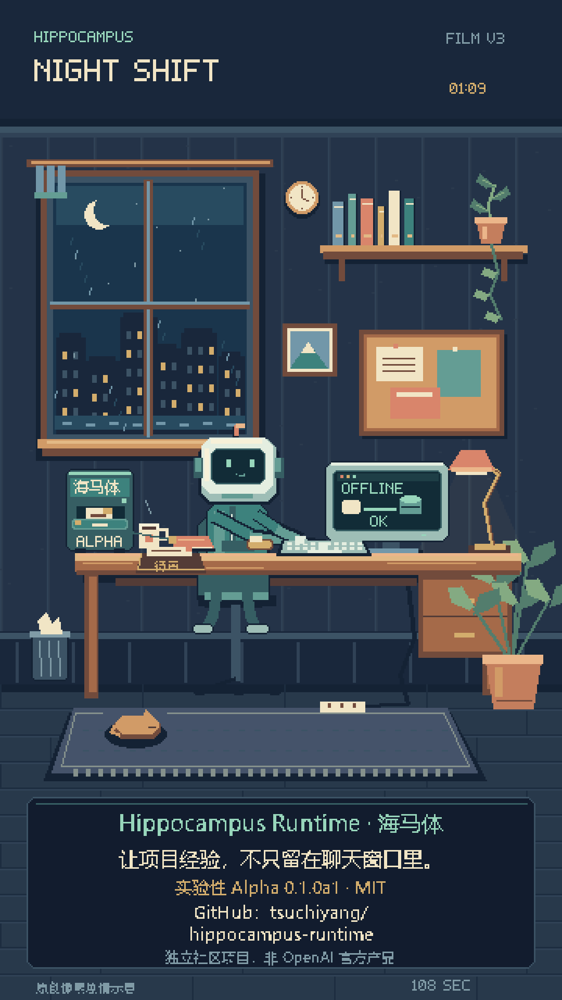

# Night Shift / 夜班

An original 108-second pixel-art story for Hippocampus Runtime: a night-shift
coding companion carries project notes across context-window changes.

This page contains a short, silent animated excerpt and the end-card poster.
The 108-second MP4 is a separate media delivery; this source checkout does not
bundle the film, production workspace, render dependencies or font binaries.
No external video-hosting availability is implied by the preview link.

End-card poster / 成片封面

## What the film does and does not claim

The character, office, screens and memories are **synthetic narrative visuals**.
This is not a real Codex recording, model evaluation, benchmark or host-acceptance
receipt. The fictional "OFFLINE OK" screen represents local memory storage; it
does not mean a cloud model works without internet or that all host/network
failure modes have been certified.

The real product remains experimental Alpha, local-first and opt-in. Installing
it does not register Hooks; dense retrieval and active injection are not enabled
by default. No unlimited-context, guaranteed-recall or production-reliability
claim is made. This is an independent community project, not an OpenAI product.

For a verifiable product demonstration rather than a story, use the
[synthetic, no-Hook quickstart](QUICKSTART.md). Current test evidence and limits
are in [known issues](KNOWN_ISSUES.md).

中文：这里是原创剧情宣传片的静音片段，不是宿主实录或验收证据；完整成片与制作工程
独立交付，不混入 Runtime 代码。画面里的“离线”不表示云端模型无需联网。
